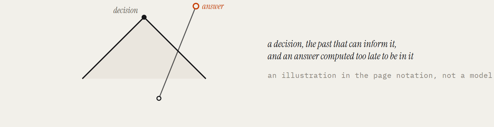
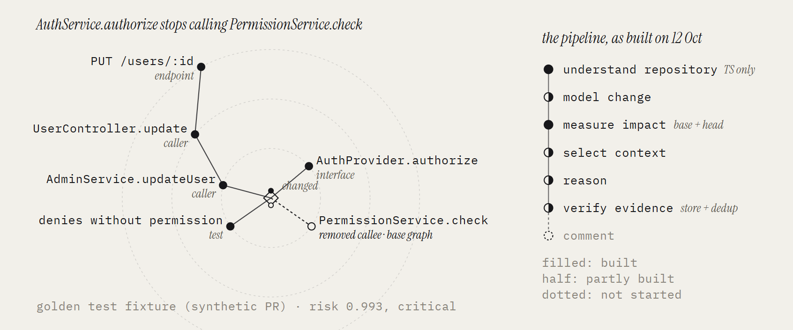

<picture>
  <source media="(max-width: 1199px) and (prefers-color-scheme: dark)" srcset="assets/profile/dark/worldline-band-mobile.png">
  <source media="(max-width: 1199px)" srcset="assets/profile/light/worldline-band-mobile.png">
  <source media="(prefers-color-scheme: dark)" srcset="assets/profile/dark/worldline-band-desktop.png">
  
</picture>

I build systems that sit at the boundary between engineering and experiment — schedulers, code-analysis tools, memory architectures — and run controlled experiments to find out where they actually stand.

<picture>
  <source media="(max-width: 1199px) and (prefers-color-scheme: dark)" srcset="assets/profile/dark/projects-mobile.png">
  <source media="(max-width: 1199px)" srcset="assets/profile/light/projects-mobile.png">
  <source media="(prefers-color-scheme: dark)" srcset="assets/profile/dark/projects-desktop.png">
  
</picture>

[temporal-compute](https://github.com/Kesh3805/temporal-compute) · [reviewgraph](https://github.com/Kesh3805/reviewgraph) · [Layered-Memory-Architecture](https://github.com/Kesh3805/Layered-Memory-Architecture)

---

## Work

**[temporal-compute](https://github.com/Kesh3805/temporal-compute)** · Rust, Python · Research

A deterministic simulator for computation whose value depends on when it finishes. The question it investigates: if a correct answer arrives after the decision it was meant to inform, was the computation successful?

Experiment TC-S1 tested two temporal-utility schedulers against four conventional baselines across 200 synthetic scenarios, with the protocol preregistered before the run.

TC-S1: assumed value curves and measured totals

 

<picture>
  <source media="(max-width: 1199px) and (prefers-color-scheme: dark)" srcset="assets/profile/dark/temporal-compute-mobile.png">
  <source media="(max-width: 1199px)" srcset="assets/profile/light/temporal-compute-mobile.png">
  <source media="(prefers-color-scheme: dark)" srcset="assets/profile/dark/temporal-compute-desktop.png">
  
</picture>

The primary scheduler (TC-S1) scored 524,509 against EDF's 552,525 — a 5.07% regression — and failed all five preregistered gates. A secondary variant came within 0.35% of EDF. Neither result is a success; both are informative. A second protocol, allocating render samples by marginal value, is registered and has not been run.

<picture>
  <source media="(max-width: 1199px) and (prefers-color-scheme: dark)" srcset="assets/profile/dark/late-answer-mobile.png">
  <source media="(max-width: 1199px)" srcset="assets/profile/light/late-answer-mobile.png">
  <source media="(prefers-color-scheme: dark)" srcset="assets/profile/dark/late-answer-desktop.png">
  
</picture>

---

**[reviewgraph](https://github.com/Kesh3805/reviewgraph)** · Rust, TypeScript · In progress

A pull-request reviewer that grounds each finding in a code graph built from the base and head of the diff. Built so far: TypeScript parsing into a persistent code graph, change-impact analysis across both graph states, risk scoring, and reviewer prompts. The verification stage stores and deduplicates findings; the checks that would re-test a finding against the base graph are not written, and it has not reviewed a real pull request end to end.

Impact graph from the test fixture, and pipeline status

 

<picture>
  <source media="(max-width: 1199px) and (prefers-color-scheme: dark)" srcset="assets/profile/dark/reviewgraph-mobile.png">
  <source media="(max-width: 1199px)" srcset="assets/profile/light/reviewgraph-mobile.png">
  <source media="(prefers-color-scheme: dark)" srcset="assets/profile/dark/reviewgraph-desktop.png">
  
</picture>

---

**[Layered-Memory-Architecture](https://github.com/Kesh3805/Layered-Memory-Architecture)** · Python · Experimental

A self-hosted conversational system for testing retrieval behaviour across a tiered memory store. The most significant result so far is negative: on a 605-chunk corpus, adding BM25 to vector search lowered MRR from 0.758 to 0.700 over 30 queries. Adding a reranker recovered it to 0.772.

MRR result and memory tier structure

 

<picture>
  <source media="(max-width: 1199px) and (prefers-color-scheme: dark)" srcset="assets/profile/dark/layered-memory-mobile.png">
  <source media="(max-width: 1199px)" srcset="assets/profile/light/layered-memory-mobile.png">
  <source media="(prefers-color-scheme: dark)" srcset="assets/profile/dark/layered-memory-desktop.png">
  
</picture>

---

## Research interests

Mathematical structures have a habit of describing physical reality more precisely than intuition suggests they should. The Schwarzschild metric, for example, predicts the behaviour of signals near a black-hole horizon with enough specificity to draw the diagram below — computed from the equations, not by hand.

Penrose diagram of a Schwarzschild black hole, computed

 

<picture>
  <source media="(max-width: 600px) and (prefers-color-scheme: dark)" srcset="assets/profile/dark/horizon-figure-mobile.png">
  <source media="(max-width: 600px)" srcset="assets/profile/light/horizon-figure-mobile.png">
  <source media="(max-width: 1199px) and (prefers-color-scheme: dark)" srcset="assets/profile/dark/horizon-figure-tablet.png">
  <source media="(max-width: 1199px)" srcset="assets/profile/light/horizon-figure-tablet.png">
  <source media="(prefers-color-scheme: dark)" srcset="assets/profile/dark/horizon-figure-desktop.png">
  
</picture>

Schwarzschild metric (G = c = 1), drawn in Kruskal–Szekeres coordinates compactified with arctan. Thick curve: observer falling from rest at r = 2.5M. Thin curve: receiver at r = 3.6M. Ink signals reach the receiver; orange ones, emitted at or inside r = 2M, end at the singularity. Full notes: <a href="DIAGRAM-NOTES.md">DIAGRAM-NOTES.md</a>.

What I find worth thinking about: whether mathematical structures like this are discovered or constructed; what it means for computation to be bounded by physical time; and how much of what is currently intractable is a limitation of available intelligence rather than of reality.

None of those are settled questions. The last one connects directly to temporal-compute.
