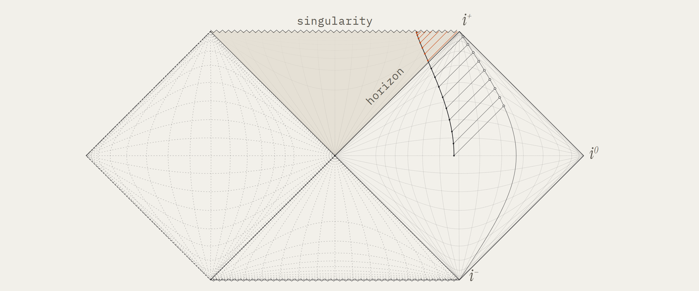
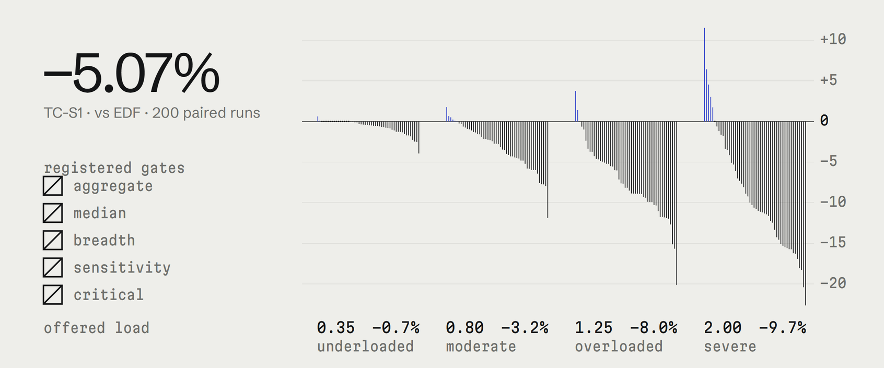

<picture>
  <source media="(max-width: 600px) and (prefers-color-scheme: dark)" srcset="assets/exports/github/dark/c2-mobile-dark.png">
  <source media="(max-width: 600px)" srcset="assets/exports/github/light/c2-mobile-light.png">
  <source media="(max-width: 1199px) and (prefers-color-scheme: dark)" srcset="assets/exports/github/dark/c2-tablet-dark.png">
  <source media="(max-width: 1199px)" srcset="assets/exports/github/light/c2-tablet-light.png">
  <source media="(prefers-color-scheme: dark)" srcset="assets/exports/github/dark/c2-desktop-dark.png">
  
</picture>

A black hole as its equations draw it (Schwarzschild solution, Penrose diagram, computed). The shaded interior can never be seen from outside; the zigzag is where the theory stops; the dotted half is allowed by the mathematics but not expected in nature. Someone falls in sending light at equal intervals: it arrives later and later, and the orange signals never arrive.

I don't think AI has made me 10 times an engineer, but 10 times a human. I think AI superintelligence could become the single most important factor in reducing the time between what humanity doesn't know and what humanity is capable of doing. Think about how long it has historically taken us to go from asking a scientific question to understanding it, discovering something useful, and eventually making it possible in the real world. I think sufficiently advanced intelligence could compress that process enormously.

Intelligence doesn't eliminate physical constraints. Experiments still take time; nature doesn't owe us shortcuts. But I wonder how much of what we consider difficult or impossible is really a limitation of our available intelligence rather than an absolute limitation of reality.

**What would change my mind:** if AI systems become dramatically more capable and that improvement consistently fails to translate into faster scientific discovery, better hypotheses, or useful new capabilities. Maybe the actual bottleneck will turn out to be experimentation, energy, resources, or something we haven't anticipated. I strongly believe in the potential of superintelligence. I don't think that means I already know what its limits are.

### Questions I keep returning to

**What is the purpose of life?** My answer keeps changing. I had one idea as a child, another as a teenager, and my ambitions are considerably bigger now. I can't tell whether purpose is something we discover, something we invent, or something that changes as we grow, and I'm not particularly interested in pretending I know.

**Are we discovering mathematics or inventing it?** Something as extreme as a black hole is beyond ordinary intuition, yet mathematics lets us describe parts of its behaviour. I haven't settled whether those structures already exist in reality or whether we're building ever more powerful languages to describe what we observe.

**If a correct answer arrives after the decision it was meant to inform, was the computation successful?** This one came out of building the scheduler below.

### Work you can inspect

**[temporal-compute](https://github.com/Kesh3805/temporal-compute)** · Rust, Python
A deterministic simulator for computation whose value depends on when it finishes. Its first registered experiment, TC-S1, pitted a temporal-utility scheduler against five conventional policies across 200 scenarios. The protocol was frozen before the run; the scheduler lost to EDF by 5.07% and failed all five gates ([results](https://github.com/Kesh3805/temporal-compute/blob/main/docs/tc-s1/results.md)). A second protocol, allocating render samples by marginal value, is registered and has not been run.

All 200 TC-S1 runs, one line each

 
<picture>
  <source media="(max-width: 1199px) and (prefers-color-scheme: dark)" srcset="assets/exports/github/dark/b-mobile-dark.png">
  <source media="(max-width: 1199px)" srcset="assets/exports/github/light/b-mobile-light.png">
  <source media="(prefers-color-scheme: dark)" srcset="assets/exports/github/dark/b-desktop-dark.png">
  
</picture>
TC-S1, measured. Each hairline is one of 200 paired scenarios: temporal-utility scheduling minus EDF, as a share of the utility available. Grouped by load, sorted. Blue is where the hypothesis did better.

**[reviewgraph](https://github.com/Kesh3805/reviewgraph)** · Rust · in progress
A pull-request reviewer that has to back each finding with base-versus-head evidence from a code graph. Large parts are built; it has not yet reviewed a real PR end to end.

**[Layered-Memory-Architecture](https://github.com/Kesh3805/Layered-Memory-Architecture)** · Python
A self-hosted chat system for testing what a memory layer should retrieve, and when. Its most useful result so far is a negative one: on a 605-chunk corpus, adding BM25 to vector search lowered MRR from 0.758 to 0.700 (30 queries).
