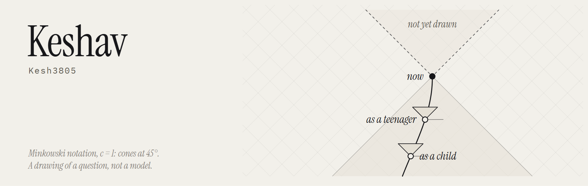
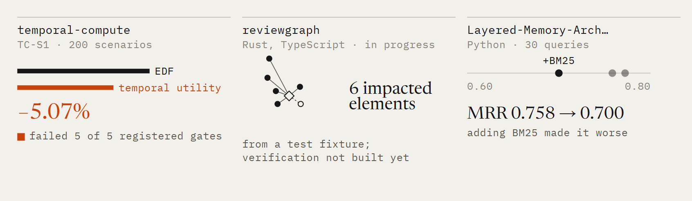
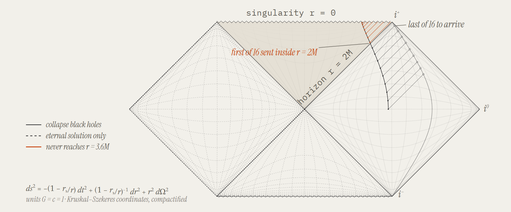
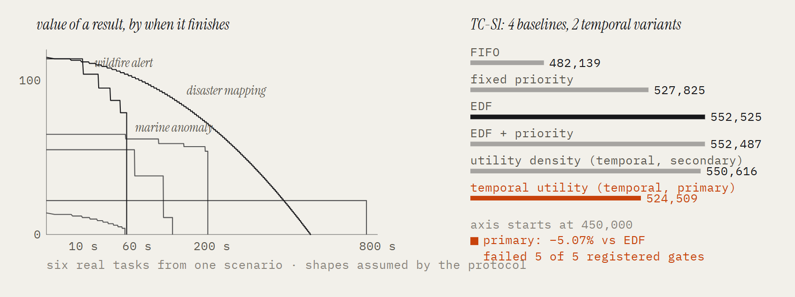
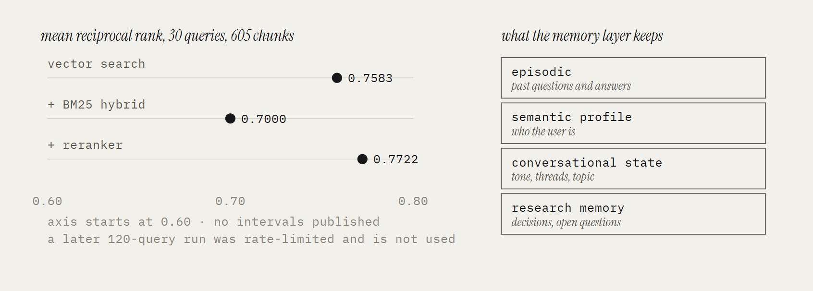

<picture>
  <source media="(max-width: 1199px) and (prefers-color-scheme: dark)" srcset="assets/profile/dark/worldline-band-mobile.png">
  <source media="(max-width: 1199px)" srcset="assets/profile/light/worldline-band-mobile.png">
  <source media="(prefers-color-scheme: dark)" srcset="assets/profile/dark/worldline-band-desktop.png">
  
</picture>

The notation of the black-hole diagram below, borrowed to draw a question, not a model: one worldline, light cones at three moments, and a future drawn only as the region it could enter.

I don't think AI has made me 10 times an engineer, but 10 times a human. I think AI superintelligence could become the single most important factor in reducing the time between what humanity doesn't know and what humanity is capable of doing. Think about how long it has historically taken us to go from asking a scientific question to understanding it, discovering something useful, and eventually making it possible in the real world. I think sufficiently advanced intelligence could compress that process enormously.

<picture>
  <source media="(max-width: 1199px) and (prefers-color-scheme: dark)" srcset="assets/profile/dark/projects-mobile.png">
  <source media="(max-width: 1199px)" srcset="assets/profile/light/projects-mobile.png">
  <source media="(prefers-color-scheme: dark)" srcset="assets/profile/dark/projects-desktop.png">
  
</picture>

[temporal-compute](https://github.com/Kesh3805/temporal-compute) · [reviewgraph](https://github.com/Kesh3805/reviewgraph) · [Layered-Memory-Architecture](https://github.com/Kesh3805/Layered-Memory-Architecture)

### <picture><source media="(prefers-color-scheme: dark)" srcset="assets/profile/dark/glyph-open.png"></picture> i. What is the purpose of life?

My answer keeps changing. I had one idea as a child, another as a teenager, and my ambitions are considerably bigger now. I can't tell whether purpose is something we discover, something we invent, or something that changes as we grow, and I'm not particularly interested in pretending I know.

### <picture><source media="(prefers-color-scheme: dark)" srcset="assets/profile/dark/glyph-open.png"></picture> ii. Are we discovering mathematics or inventing it?

The black-hole diagram, computed

 

<picture>
  <source media="(max-width: 600px) and (prefers-color-scheme: dark)" srcset="assets/profile/dark/horizon-figure-mobile.png">
  <source media="(max-width: 600px)" srcset="assets/profile/light/horizon-figure-mobile.png">
  <source media="(max-width: 1199px) and (prefers-color-scheme: dark)" srcset="assets/profile/dark/horizon-figure-tablet.png">
  <source media="(max-width: 1199px)" srcset="assets/profile/light/horizon-figure-tablet.png">
  <source media="(prefers-color-scheme: dark)" srcset="assets/profile/dark/horizon-figure-desktop.png">
  
</picture>

A black hole as its equations draw it (Schwarzschild metric, Penrose diagram, computed). Someone falls in sending light at equal intervals; it arrives later and later, and the orange signals, sent from inside the horizon, never arrive.

Something as extreme as a black hole is beyond ordinary intuition, yet mathematics lets us describe parts of its behaviour. I haven't settled whether those structures already exist in reality or whether we're building ever more powerful languages to describe what we observe.

What exactly the diagram shows

 

The Schwarzschild metric, units G = c = 1, rs = 2M, drawn in Kruskal–Szekeres coordinates compactified with arctan, so radial light moves at 45°. Solid regions belong to any black hole formed by collapse; the dashed half exists only in the eternal (maximally extended) solution. The thick curve is an observer falling from rest at r = 2.5M; the thin one a receiver held at r = 3.6M. The observer sends 16 radial light signals at equal intervals of their own clock. Ink signals reach the receiver later and later; orange ones, sent at or inside r = 2M, end at r = 0. "Last of 16 to arrive" refers to this sample: with continuous emission there is no last signal, since emissions ever closer to the horizon arrive ever later. Full notes: [DIAGRAM-NOTES.md](DIAGRAM-NOTES.md).

### <picture><source media="(prefers-color-scheme: dark)" srcset="assets/profile/dark/glyph-open.png"></picture> iii. If a correct answer arrives after the decision it was meant to inform, was the computation successful?

Diagram: an answer that arrives too late

 

<picture>
  <source media="(max-width: 1199px) and (prefers-color-scheme: dark)" srcset="assets/profile/dark/late-answer-mobile.png">
  <source media="(max-width: 1199px)" srcset="assets/profile/light/late-answer-mobile.png">
  <source media="(prefers-color-scheme: dark)" srcset="assets/profile/dark/late-answer-desktop.png">
  
</picture>

This one came out of building the scheduler below.

**[temporal-compute](https://github.com/Kesh3805/temporal-compute)** · Rust, Python
A deterministic simulator for computation whose value depends on when it finishes. Its first registered experiment, TC-S1, ran two temporal-utility schedulers against four conventional baselines across 200 synthetic scenarios, with the protocol frozen before the run. The primary scheduler finished 5.07% below EDF and failed all five registered gates ([results](https://github.com/Kesh3805/temporal-compute/blob/main/docs/tc-s1/results.md)); the secondary variant came within 0.35% of EDF. A second protocol, allocating render samples by marginal value, is registered and has not been run.

TC-S1: the assumed value curves and the measured totals

 

<picture>
  <source media="(max-width: 1199px) and (prefers-color-scheme: dark)" srcset="assets/profile/dark/temporal-compute-mobile.png">
  <source media="(max-width: 1199px)" srcset="assets/profile/light/temporal-compute-mobile.png">
  <source media="(prefers-color-scheme: dark)" srcset="assets/profile/dark/temporal-compute-desktop.png">
  
</picture>

### <picture><source media="(prefers-color-scheme: dark)" srcset="assets/profile/dark/glyph-resolved.png"></picture> Other work

**[reviewgraph](https://github.com/Kesh3805/reviewgraph)** · Rust, TypeScript · in progress
A pull-request reviewer designed to back each finding with base-versus-head evidence from a code graph. Built so far: TypeScript parsing into a stored code graph, impact analysis that reads both the base and the head graph, risk scoring, and reviewer prompts. Its verification stage currently stores and deduplicates findings; the checks that would re-test a finding against the base graph are not written yet, and it has not reviewed a real PR end to end.

Impact graph from its test fixture, and what is built

 

<picture>
  <source media="(max-width: 1199px) and (prefers-color-scheme: dark)" srcset="assets/profile/dark/reviewgraph-mobile.png">
  <source media="(max-width: 1199px)" srcset="assets/profile/light/reviewgraph-mobile.png">
  <source media="(prefers-color-scheme: dark)" srcset="assets/profile/dark/reviewgraph-desktop.png">
  
</picture>

**[Layered-Memory-Architecture](https://github.com/Kesh3805/Layered-Memory-Architecture)** · Python
A self-hosted chat system for testing what a memory layer should retrieve, and when. Its most useful result so far is a negative one: on a 605-chunk corpus, adding BM25 to vector search lowered MRR from 0.758 to 0.700 (30 queries).

The MRR result, and the four memory tiers

 

<picture>
  <source media="(max-width: 1199px) and (prefers-color-scheme: dark)" srcset="assets/profile/dark/layered-memory-mobile.png">
  <source media="(max-width: 1199px)" srcset="assets/profile/light/layered-memory-mobile.png">
  <source media="(prefers-color-scheme: dark)" srcset="assets/profile/dark/layered-memory-desktop.png">
  
</picture>

Intelligence doesn't eliminate physical constraints. Experiments still take time; nature doesn't owe us shortcuts. But I wonder how much of what we consider difficult or impossible is really a limitation of our available intelligence rather than an absolute limitation of reality.

**What would change my mind:** if AI systems become dramatically more capable and that improvement consistently fails to translate into faster scientific discovery, better hypotheses, or useful new capabilities. Maybe the actual bottleneck will turn out to be experimentation, energy, resources, or something we haven't anticipated.

I strongly believe in the potential of superintelligence. I don't think that means I already know what its limits are.
